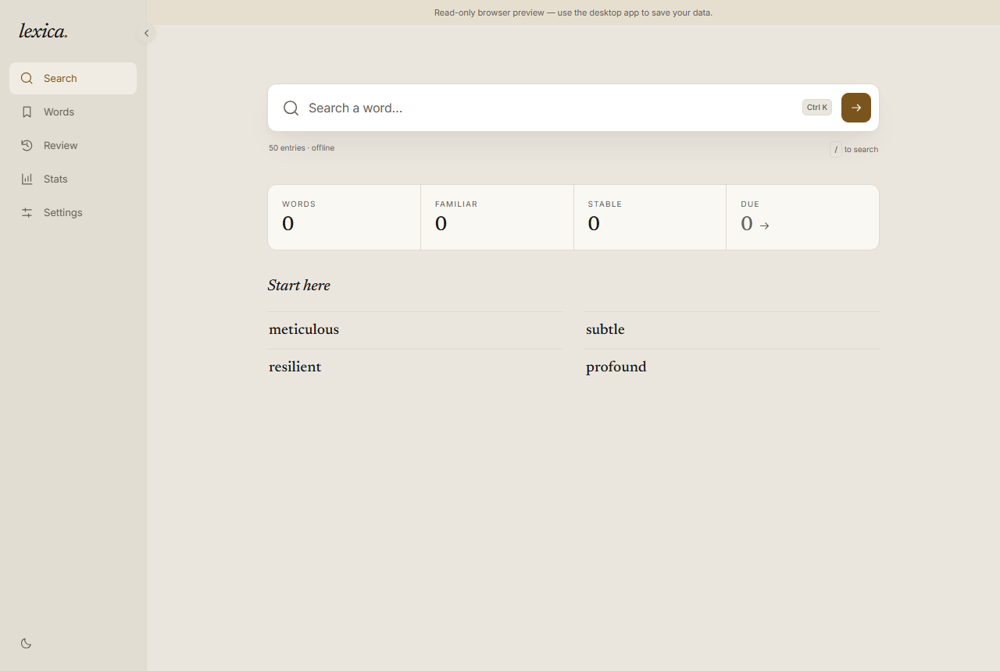
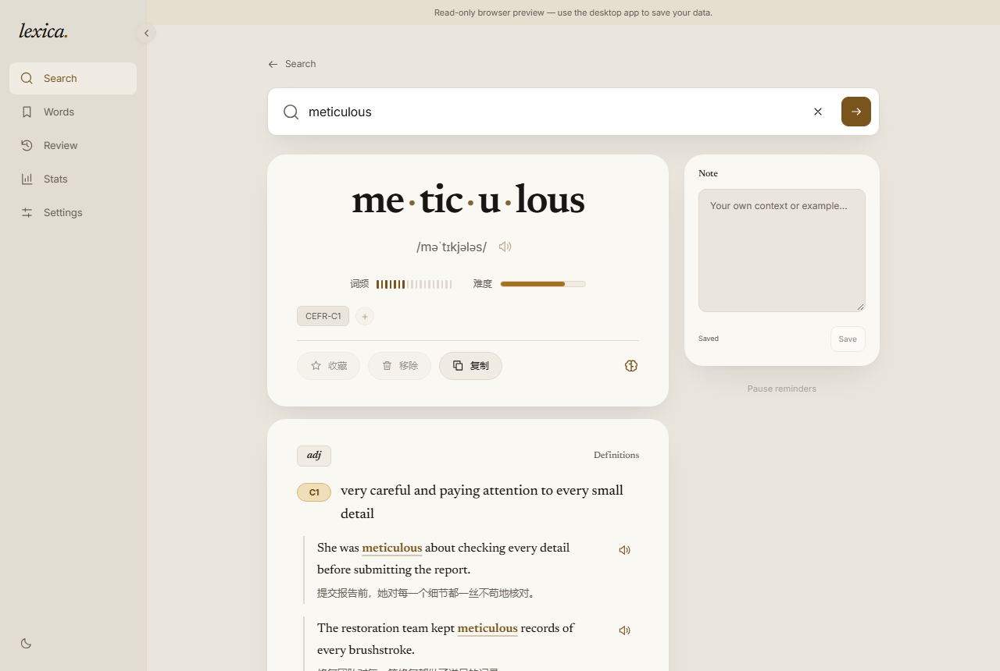
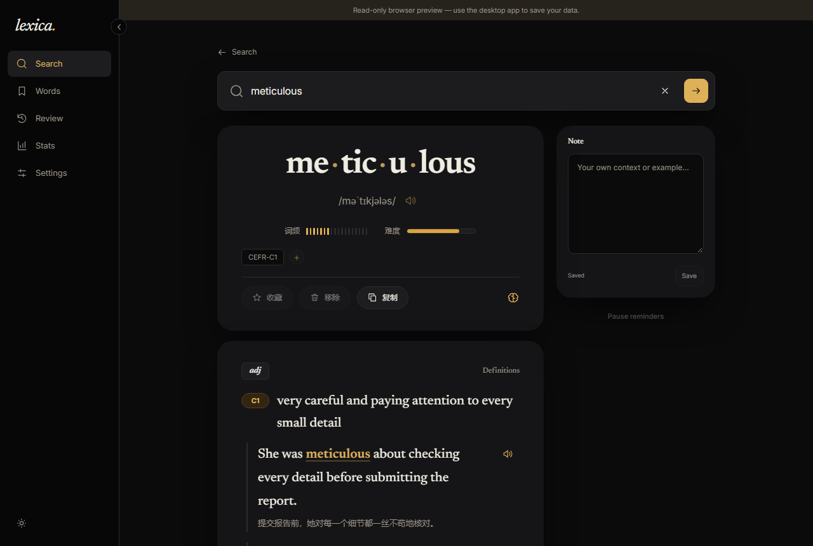
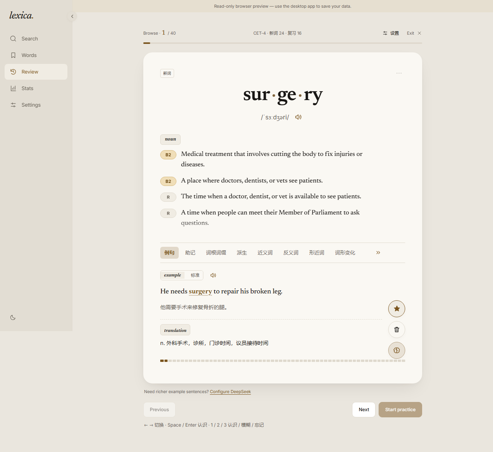
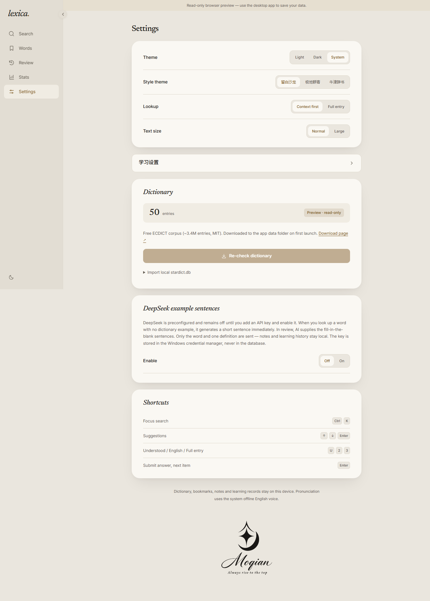
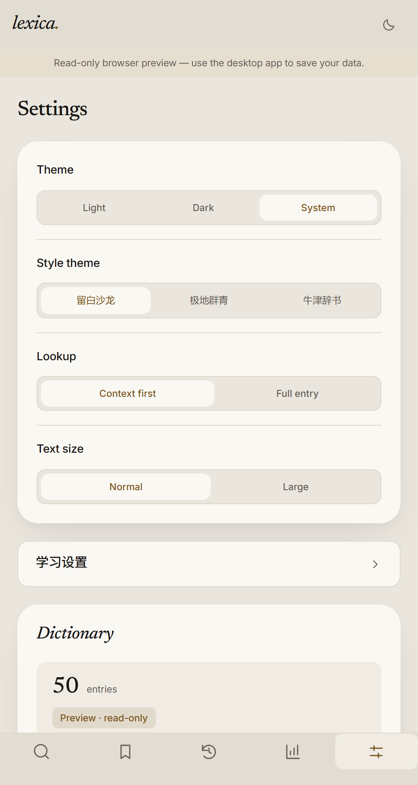

# Lexica.

> 一本尽量让自己变得多余的本地英语词典。

[](https://github.com/YinLingxiao/Lexica./releases/latest)
[](https://github.com/YinLingxiao/Lexica./releases)


**Tauri 2 · Rust · SQLite / FTS5 · SvelteKit 5**

查一个词，按书页的方式读完，把值得记住的留下。词典、笔记、收藏和复习计划都在这台电脑上。Lexica 为两件日常的事而做：阅读时顺手查词，以及从一本词书里走完一组短学习。



---

## 下载

Windows 10 / 11（x64）。WebView2 通常已经装好。

| 文件 | 大小 | 说明 |
| --- | --- | --- |
| **[Lexica-setup.exe](https://github.com/YinLingxiao/Lexica./releases/latest/download/Lexica-setup.exe)** | 约 3.5 MB | **推荐。** NSIS 安装包，带开始菜单和桌面快捷方式 |
| [Lexica.msi](https://github.com/YinLingxiao/Lexica./releases/latest/download/Lexica.msi) | 约 5.3 MB | 适合静默安装或企业部署 |

上面是固定的 `latest` 链接。指定版本见 [Releases](https://github.com/YinLingxiao/Lexica./releases)。

> 安装包目前**没有签名**。Windows SmartScreen 可能提示未知发布者。选择**更多信息 → 仍要运行**。

---

## 能做什么

### 查词

首页就是一个搜索框。输入前缀会打开建议列表，方向键和 Enter 选中词条。屈折形式会回到词头（`running` → `run`）。搜索框下面是最近查过的词，以及几个起步词。也可以直接打开 `/?word=meticulous`。

词条是一页阅读，不是一叠管理卡片：

- 词头先以完整单词出现，再拆成音节（`me·tic·u·lous`）。分隔点依次展开。在 **Settings → 学习设置 → 自动分音节** 里关掉；学习卡用同一个开关。
- 音标和喇叭。发音走 Windows 离线英语语音（美音或英音，语速 0.8 / 1 / 1.2）。
- 有数据时显示词频刻度、难度条和 CEFR 标签。
- **Context first** 先给一个义项和例句，点 **Full entry** 展开其余义项。在设置里选 **Full entry** 则每次都展开全部。
- 例句里词头会高亮，中文跟在英文下面。
- 再往下，有数据才出现：词形变化、助记、词根词缀、派生、形近词、近义词、反义词、搭配。
- 词条旁边可以写私人笔记。可以收藏、移除、复制整条，或暂停这个词的复习提醒。

浏览器预览里这些写入是禁用的。桌面应用才会保存。

### 词书学习

**Review** 是一组学习，不是一堵待复习卡片墙。

在 **学习设置** 里选词书：

| 词书 | 标识 |
| --- | --- |
| CET-4、CET-6、考研、高考 | `cet4` `cet6` `ky` `gk` |
| TOEFL、IELTS、GRE | `toefl` `ielts` `gre` |
| Oxford 3000 | `oxford` |
| 自己收藏的词 | `custom` |
| 查过的词 | `encountered` |

一组里新词和复习混在一起。可以设每日新词上限（10、20、40、60、100）、混合方式（`mixed`、新词优先、复习优先）和学习计划（`standard`、`intensive`、`casual`）。

每张卡片有：

- 按音节拆开的词头、音标和喇叭。
- 词性和带 CEFR 的英文释义。
- 八个扩展栏：例句、助记、词根词缀、派生、近义词、反义词、形近词、词形变化。栏可以在学习设置里关掉或调整顺序。例句可以偏好标准句或真题句，按存储顺序或随机。
- 中文可以一直显示，也可以点一下才出现。
- **Context** 模式先给例句，完整释义等你自己点开。

用记忆按钮或键盘评分：

| 按键 | 评分 | 结果 |
| --- | --- | --- |
| Space、Enter 或 1 | 认识 | 这个词离开本组 |
| 2 | 模糊 | 记为模糊，进入下一个词 |
| 3 | 忘记 | 这个词排到本组末尾 |

星标用来收藏。垃圾桶把词标成熟知，不再安排学习。底部刻度表示这组走到哪里。**Previous** / **Next** 只翻页，不评分。浏览完一组后，**Start practice** 进入当组填空：先给首字母，再给英文释义，再给中文释义。就算例句来自 AI，这次评分也在本机完成。

### 词库、统计和外观

**Words** 列出遇到过的词。可以搜索，或按 Saved、Learning、Familiar、Stable、Paused 筛选。点开一行会重新查这个词。每个词可以单独暂停或恢复提醒。`/library?filter=bookmarked` 可以直接打开某个筛选。

**Stats** 显示遇到过多少词、熟悉和稳定的有多少、现在到期多少、近 14 天的查词和复习、记忆阶段分布，以及正在淡忘的词。

**Settings** 收齐了以前浮在界面上的开关：

- **Theme**：Light、Dark 或 System。侧栏月亮按钮切换时，从指针处做圆形展开。系统开启“减少动态效果”时直接切换，不做动画。
- **Style theme**：留白沙龙、极地群青、牛津辞书。改的是字体、颜色和词条的版式线条。只能在这里选。
- **Lookup**：Context first 或 Full entry。
- **Text size**：Normal 或 Large。Large 会加大阅读文字。
- **学习设置**：上面说的词书、卡片、计划、语音、例句、音节和扩展栏。
- **Dictionary**：词条数量、重新检查，或导入自己的 `stardict.db`。
- **DeepSeek example sentences**：可选，默认关闭。
- **Shortcuts**：应用里列着。Ctrl K 聚焦搜索，方向键和 Enter 选建议，U / 2 / 3 切换查词层级，Enter 提交练习答案。

宽窗口里侧栏可以收成图标。宽度低于 760px 时，侧栏变成顶栏，底部出现标签栏。

### AI 例句

默认关闭。某个义项没有例句时，查词可以向你配置的接口要一句短句。复习填空也可以用这句。评分始终在本地算。

- 默认是 DeepSeek：`https://api.deepseek.com/v1` 和 `deepseek-chat`。任何 OpenAI 兼容接口都可以。
- API Key 存在 **Windows 凭据管理器**里，不进 SQLite、localStorage 或日志。界面只知道有没有钥匙，看不到钥匙本身。
- Rust 会先检查返回（义项 id、非空句子、目标词是整词）再交给界面。
- 按单词、义项、接口、模型和提示词版本缓存。
- 超时 15 秒，不自动重试。失败就退回本地释义或例句。

---

## 截图

| | |
| --- | --- |
|  |  |
| 首页。先搜索，下面是几个起步词。 | `meticulous`，音节已展开，语境和完整词条的开头。 |
|  |  |
| 同一词条的深色、大字号。 | `surgery` 的学习卡：释义、例句和评分按钮。 |
|  |  |
| 设置：主题、风格、词典和可选的 AI。 | 同一页在 480px 下，底部是标签栏。 |

> 这些是**浏览器只读预览**（50 个种子词，所以词典一行写着 `50 entries · offline`）。桌面应用用的是完整 ECDICT。版式和操作一致，保存不行。顶上那条预览提示只在浏览器里出现。

---

## 第一次打开

1. **词典。** Lexica 会把免费的 ECDICT（约 200 MB 的 zip，大约 340 万词条，MIT）下载到应用数据目录并导入。导入可能要几分钟。也可以先跳过，以后在设置里导入自己的 `stardict.db`。
2. **语音。** 喇叭没声音时，到 Windows 设置 → 时间和语言 → 语音，安装一个英语离线语音包。
3. **学习。** 打开 Review。默认词书是 CET-4，每天 40 个新词，音节拆分开着。要改的话去 Settings → 学习设置。
4. **AI 例句**（可选）。在设置里打开，贴上 Key，再测一次连接。

---

## 怎么做的

业务规则在 Rust 里。前端负责页面、交互和外观偏好。

```
src-tauri/src/
├── domain/       纯模型（不做 I/O）
├── dictionary/   FTS5 查词、建议、屈折、词根、ECDICT 下载
├── memory/       记忆状态投影和调度
├── review/       学习组、填空练习、评分
├── library.rs    收藏、笔记、词表、活动
├── ai.rs         可选的例句生成
├── database/     连接、只追加的迁移、时间戳
├── commands/     Tauri IPC
├── app.rs        应用状态和数据目录
└── bin/          无界面的 import-ecdict 工具
```

```
src/
├── routes/       /  ·  /library  ·  /review  ·  /stats  ·  /settings
├── lib/api.ts    IPC 封装。浏览器里换成预览桩。
├── lib/preview.ts    npm run dev 和 Playwright 用的只读夹具
├── lib/syllables.ts  词头分音节，查词和学习共用
├── lib/tts.ts        系统语音
└── lib/components/   WordView、StudyWordCard、SyllableHeadword、设置
```

- `encounters` 和已完成的 `reviews` 是**事实来源**。`memory_states` 是可以重建的**投影**。
- 迁移只追加（`PRAGMA user_version`）。词书和学习评分在 `0005_study_system.sql`。
- 数据库在应用数据目录。`db_dir.txt` 可以改存储位置，重启后生效。
- 外观（主题、风格、字号、阅读密度，以及整份学习偏好）只属于这个窗口，存在 `localStorage` 的 `lexica.preferences` 里，不进词典数据库。

---

## 开发

需要 **Node.js**、**Rust（MSVC）**、**Windows C++ 生成工具**和 **WebView2**。

```bash
npm install
npm run tauri dev
```

这会在 `http://127.0.0.1:5173` 启动 Vite，并打开桌面窗口。窗口才是真正的应用：ECDICT、SQLite 和凭据存储。

只要前端、50 词的只读预览：

```bash
npm run dev
```

---

## 构建

### 独立可执行文件

```bash
npm run build
cd src-tauri
cargo build --release --features custom-protocol --bin lexica
```

产物：`src-tauri/target/release/lexica.exe`。

发布构建必须带 `custom-protocol`。没有它，程序无法提供内嵌的 `build/` 资源。

### Windows 安装包

```bash
npm install
npm run tauri build
```

- `src-tauri/target/release/bundle/msi/Lexica_0.1.0_x64_en-US.msi`
- `src-tauri/target/release/bundle/nsis/Lexica_0.1.0_x64-setup.exe`

发布前先改 `src-tauri/tauri.conf.json` 里的 `version`。

### 无界面导入 ECDICT

```bash
cargo run --release --bin import-ecdict -- <stardict.db> <lexica.db>
```

目标库不存在时会创建并迁移。再跑一次是安全的。

---

## 发布

> 这个仓库**不用 GitHub Actions**。
>
> 仓库名以句点结尾（`Lexica.`）。Windows 运行器的路径是 `D:\a\<名字>\<名字>`，Windows 建不出末尾带点的目录，所以 `actions/checkout` 在任何步骤之前就会失败。

在已经装好工具链的机器上：

```bash
npm run tauri build
node scripts/publish-release.mjs
```

脚本从 `tauri.conf.json` 读版本，创建或更新 `v<版本>` 发布，并同时上传带版本号的文件和稳定文件名（`Lexica-setup.exe`、`Lexica.msi`）。之后 `releases/latest/download/...` 指向这次构建。

发布说明来自 [`docs/release-notes-template.md`](docs/release-notes-template.md)。

```bash
node scripts/publish-release.mjs --skip-build
node scripts/publish-release.mjs --replace
node scripts/publish-release.mjs --tag v0.2.0
```

认证用 `GITHUB_TOKEN`，或 Git 凭据助手。在已经登录的 Windows 上，助手通常就够。

---

## 测试

```bash
npm run check
npm run build
npx playwright install chromium
npm run test:e2e
cd src-tauri
cargo test
cargo clippy --all-targets -- -D warnings
```

- Playwright 覆盖预览界面和 IPC 夹具：建议列表、收藏、学习卡、提示顺序、防重复提交、主题展开、AI 回退，以及窄屏。其中几个测试也会写出 `docs/screenshots/`。
- Rust 测试覆盖真实的 SQLite 存储和记忆规则。

---

## 隐私

- 词典、收藏、笔记和复习记录都在**本地** SQLite。
- 联网只有两处：第一次启动时**下载 ECDICT**，以及你打开之后的**可选 AI 例句**。
- 打开 AI 后，发出去的只有当前单词和义项，而且只发到你配置的接口。评分留在本地。
- API Key 留在 Windows 凭据管理器里。

---

## 限制

- 只有 Windows x64（MSI 和 NSIS）。
- 安装包未签名，第一次打开会有 SmartScreen 提示。
- 发音需要系统里的英语语音包。
- 第一次导入词典大约要下载 200 MB，除非你自己带 `stardict.db`。
- AI 例句需要你自己的 API Key，可能向该服务商付费。
- 浏览器预览不能保存。收藏、笔记和学习进度请用桌面应用。
- 音节拆分是本地启发式加上一小份整理过的词表。它是阅读辅助，不是权威音标。

---

## 许可

[MIT](LICENSE) © YinLingxiao

可以自由使用、修改和分发，包括商用，保留版权声明即可。

---

## 致谢

评审记录和后续事项：[PROJECT_REVIEW.md](docs/PROJECT_REVIEW.md)。

词典数据：[ECDICT](https://github.com/skywind3000/ECDICT)（MIT）。
